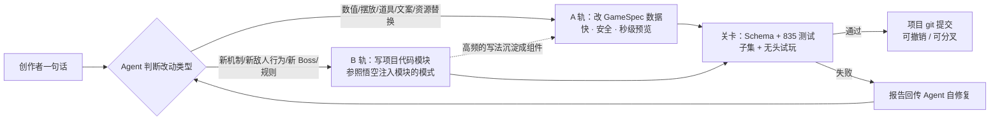
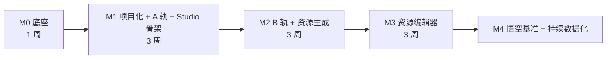

# AI 游戏创作工具：规划 v3（基于源码，适配一人 + AI 编程）

## 〇、决策汇总

| 项 | 决策 |
|---|---|
| 源码 | 已上传：`魂斗罗与孙悟空-源码-20261105/contra-wukong-source-20261105` |
| 用户 | 内部创作者，以对话为主，资源可视化编辑 |
| 部署 | 一台云服务器，内测只有几个人用 |
| AI | 只接 Gemini，模型 ID 全部写在配置里 |
| 样例 | 悟空模式（在魂斗罗基础上改出来的） |
| 开发 | **一个人 + AI 编程** |

---

## 一、源码的新发现（比发布包好很多）

| 发现 | 证据 | 意义 |
|---|---|---|
| **测试很完整** | `backend/test/` 下 68 个文件，`contra-*` 和 `wukong-*` 共 **835 个测试全部通过，耗时约 27 秒**（我已在 VM 上实测） | 重构的安全网**已经现成**，不用再从零写回放测试 |
| **已经有无头引擎** | [contra-engine.test.mjs](../backend/test/contra-engine.test.mjs#L68-L141) 里的 `engine()` 函数：用 `vm` 沙箱加一个什么都不画的 canvas 运行真实引擎，并注入测试钩子，暴露 `G`、`step`、`play`、`render` 等 | 抽出来就是**无头模拟器**，直接给 Bot 自动试玩和 AI 自检用 |
| **悟空已经是插件形态** | [wukong/js/main.mjs](../games/wukong/js/main.mjs) 调用 `startArcade(wukongDependencies)`；[engine-dependencies.mjs](../games/wukong/js/engine-dependencies.mjs) 把皮肤、规则、敌人、音乐等打包注入引擎 | "游戏 = 引擎 + 一个注入模块"这个模式**已经跑通了**，只需要把它通用化 |
| **原作本身就是 AI 做出来的** | `design/` 里有 165 个文件，包括 `*-prompts.json`（图像生成提示词）、`*-qa.json`（尺寸核对）；`tools/` 里有 Python 后处理脚本（测尺寸、压缩、拼图集） | 平台要做的，就是把这套"AI 生图 → 后处理 → 接入引擎 → 测试验证"的流程**产品化** |
| 部署已有 | `compose.yaml`、Caddy、Dockerfile、systemd、nginx 配置 | 云服务器部署可以直接复用 |
| 多余的东西 | 后台还带着军棋和干瞪眼；`unified.test` 因为缺少其他游戏而失败 | M0 清理掉 |

---

## 二、v3 的关键调整："两条腿"创作

v2 的思路是先把所有关卡和机制都抽象成声明式组件，AI 只改数据。**这对一个人来说工作量太大**：16 关加悟空，大约 9000 行硬编码逻辑。

v3 改成两种改法并行：



- **A 轨（数据）**：先抽出最常改的表格，包括武器、道具、掉落、敌人血量和分数、主角物理、生命数、关卡顺序、文案、音乐分配、资源映射。
- **B 轨（代码）**：Studio 里的 Gemini Agent 在**这个项目自己的目录**里写 `modules/*.mjs`（和悟空的 `engine-dependencies.mjs` 是同一种形态），然后运行测试和无头试玩来验证。内部工具的用户都是可信的，所以沙箱只需要轻量隔离（每次运行开一个独立的 Node 子进程，带超时）。
- **逐步数据化**：B 轨里反复出现的写法，再沉淀成 A 轨的组件。按实际需求一点点推进，不提前把所有东西都抽象掉。

> [!IMPORTANT]
> 引擎重构走"渐进替换"的路线：**每一步都保持 835 个测试全绿**，一次只把一张表或一类分支改成读取规格或钩子。不做大重写，不引入打包构建（游戏本身继续是原生 ESM，开箱就能跑）。

---

## 三、项目与运行时形态

```
projects/<id>/                 ← 一个创作项目 = 一个 git 仓库
  game.json                    GameSpec（extends 模板 + 覆盖）
  modules/*.mjs                B 轨代码模块（钩子 / 新敌人 / 新规则）
  assets/                      项目自己的资源（生成或编辑出来的）
  history: git log             每次 AI 改动都是一次提交，撤销 = git revert
```

- **引擎入口通用化**：现在是 `startArcade(wukongDependencies)`，改成 `startArcade(loadProject(id))`。`loadProject` 会合并模板、`game.json` 和 `modules`。
- **两个内置模板**：
  - `template:contra`：魂斗罗 8 关（后面可以再开放 9–16 关原型）；
  - `template:wukong`：作为"变体样例"，逐步改写成 `extends contra + 覆盖 + modules`。
- **钩子**：在引擎里逐步加入 `onDamage`、`onKill`、`onSpawn`、`onItem`、`drawHud`、`updateStage`、`drawStage` 等钩子。引擎里 179 处 `WUKONG` 分支就是第一批钩子的来源清单。

---

## 四、Gemini 配置

```yaml
# server/config/ai.yaml（API Key 只放在环境变量 GEMINI_API_KEY 里）
provider: gemini
models:                      # 具体 ID 以官方模型页为准，随时可以换
  agent:        <gemini 旗舰或 Flash 型号>      # 规划 + 函数调用 + 写代码，需要长上下文
  fast:         <gemini Flash-Lite 型号>        # 分类路由、短文本、摘要
  vision:       <同 agent>                      # 截图评审、看参考图
  image:        <Nano Banana 系列>              # 文生图 + 带参考图编辑 + 多轮一致性
  image_pro:    <Nano Banana Pro>               # 封面、高质量关键美术
  music:        <Lyria 3.5 / Lyria Clip>        # 关卡 BGM / 短循环
  tts:          <Gemini Flash TTS>              # 角色台词（悟空已有配音流程）
budget: { dailyUSD: 30, perTurnMaxTokens: 400000 }
cache: { contextCaching: true }   # 把引擎目录、组件清单、GameSpec Schema 做上下文缓存，降低成本
```

- 用官方 `@google/genai` SDK，写一个很薄的 `ai/gemini.mjs` 封装；接口仍然按"能力"来设计，以后要换供应商只需要换一个文件。
- **函数调用 + 结构化输出**：GameSpec 的修改用 JSON Schema 约束输出。
- **图像一致性**：每个项目保存一组"风格参考图"，所有生图和改图都带上它们。原作 `design/*-prompts.json` 里的提示词写法直接拿来当模板。
- **可观测性**：每次调用都把 prompt、响应、token 和费用写进 SQLite，Studio 里可以看。

---

## 五、Agent 工具集

| 工具 | 轨道 | 说明 |
|---|---|---|
| `spec_get` / `spec_patch` | A | 读取和修改 `game.json`（JSON Patch） |
| `catalog` | A/B | 列出模板、组件、钩子和资源清单 |
| `code_read` / `code_write` | B | 只能读写本项目的 `modules/`；引擎源码只读 |
| `run_checks` | A/B | Schema 校验 + 相关测试子集 + 加载冒烟测试 |
| `playtest` | A/B | 无头 Bot 跑 N 局，返回通关率、死亡热点和关键帧截图 |
| `screenshot` | A/B | 无头渲染指定关卡、指定位置的画面（M2 用 node-canvas 实现真实渲染） |
| `image_gen` / `image_edit` | 资源 | Nano Banana + 后处理（去背景、像素对齐、切帧、拼图集） |
| `music_gen` / `tts` | 资源 | Lyria / TTS → 转成 ogg（Opus），并登记到资源清单 |
| `commit` / `revert` | 版本 | 每一轮对话结束自动提交，提交说明由 AI 生成 |

---

## 六、Studio（内部 Web）

- **布局**：左边是项目和版本历史，中间是**对话**，右边是**实时预览**（iframe，改动后热重载，可以跳到指定关卡和位置，可以叠加碰撞框和刷怪点的调试层）。
- **资源编辑器**（M3）：资源库、切帧和锚点、受击框、调色板换色、像素修补、**框选区域让 AI 局部重绘**、骨骼部件替换、视差图层、音频分配。
- **技术**：Vite + React，只用在 Studio 里；后端是 Node（Express，依赖里已经有），数据库用 SQLite，资源放本地磁盘，项目版本用 git CLI 管理。
- **访问控制**：Caddy 做 Basic Auth，或者用邀请码，给几个人用够了。

---

## 七、里程碑（一人 + AI 编程，按周计）



### M0 底座（1 周）——批准后可以马上开始
- [ ] 调整仓库结构：源码提升到仓库根目录（`games/`、`backend/`、`tools/`）；发布包从主分支移走，打一个 tag 存档（仓库体积大约减半）
- [ ] 移除军棋、干瞪眼和 `unified` 相关内容，`npm test` 只跑魂斗罗和悟空
- [ ] 设置 GitHub Actions，每次推送都跑这 835 个测试
- [ ] 把测试里的 `engine()` 抽成可复用的 `sim/headless.mjs`（测试和 Agent 共用）
- [ ] 每关录制一段"输入序列 → 状态哈希"作为黄金回放，用来做 Bot 试玩的基线
- [ ] 写 `AGENTS.md`：架构说明、红线（测试必须全绿、不碰联机协议等），供 AI 编程助手和 Studio Agent 共同遵守
- [ ] 资源去重：png 和 webp 只保留运行时实际用到的那一份，源图挪到 `design/source-art`

### M1 项目化 + A 轨 + Studio 骨架（3 周）
- [ ] `startArcade(loadProject())` 通用化，悟空改成走同一个入口
- [ ] 抽出第一批表到 `templates/contra/game.json`，并为 GameSpec 写好 Schema
- [ ] 服务端：项目增删改查、每个项目一个 git 仓库、预览路由（`/play/<project>`）、Gemini 封装
- [ ] Studio：对话、预览热重载、版本历史和撤销
- **验收**：一句话把机枪射速、生命数、敌人血量、道具掉落改掉，30 秒内在预览里看到效果，可以撤销

### M2 B 轨 + 资源生成（3 周）
- [ ] 第一批钩子（从 `WUKONG` 分支提炼），加上 `modules/` 加载机制
- [ ] Agent 代码工具 + `run_checks` + `playtest` 闭环
- [ ] 生图和改图管线（Nano Banana + 风格参考 + 后处理）；把原作的 Python 工具改写成 Node（sharp），或者用 Python worker 调用
- **验收**：一句话加一种"会飞、会俯冲的敌人"，包括美术和行为，自动测试通过后进入预览

### M3 资源编辑器（3 周）
- [ ] 第六节列出的编辑器功能，所有编辑写回资源清单并提交
- **验收**：一套主角加敌人的换皮，能通过"对话生成 + 手工微调"在半天内完成

### M4 悟空基准 + 持续数据化
- [ ] 从 `template:contra` 出发，用对话复刻出悟空第 1 关的核心差异（血量、怒气大招、法术、回血、天庭美术、开场故事）
- [ ] 把 B 轨里高频的写法沉淀成 A 轨组件；可选开放第 9–16 关原型作为模板

---

## 八、一人开发的工作方式建议

- **测试是唯一的安全网**：每次 AI 编程改动都要跑 `npm test`，红了就回滚，不把问题带到下一步。
- **小步提交**：一次只抽一张表、只加一个钩子；每一步都能独立回滚。
- **AGENTS.md 先行**：把架构、目录约定、红线写清楚，AI 编程助手才能稳定输出。
- **先用自己的工具做游戏**：从 M1 开始就用 Studio 改游戏，痛点就是下一步的需求。

---

## 九、风险

| 风险 | 应对 |
|---|---|
| 引擎单文件 8774 行，改动容易误伤 | 835 个测试 + 黄金回放 + 小步提交 |
| B 轨代码质量不稳定 | 只允许写项目自己的 `modules/`；通过钩子 API 访问引擎；必须过测试和试玩 |
| Gemini 模型更替快 | 模型 ID 只写在配置里，并保留一个小评测集，换模型前先回归一遍 |
| 生图风格和尺寸不一致 | 风格参考图 + 原作提示词模板 + 自动尺寸检查（原作 `*-qa.json` 的做法） |
| 成本 | 上下文缓存、每日预算上限、能用 Flash-Lite 的地方就不用旗舰模型 |

---

## 十、已确认（2026-11-05）
1. 源码提升到仓库根目录；发布包和源码包分别存档在 tag `archive/release-20261105` 和 `archive/source-20261105`。
2. M1 先只做主线 1–8 关；9–16 关原型以后再开放。
3. M0 已开始，进度见下一节。

## 十一、M0 进度
- [x] 仓库结构调整，移除军棋、干瞪眼和 `unified` 相关内容
- [x] GitHub Actions：每次推送和 PR 都跑全部测试
- [x] 无头引擎抽成 `sim/headless.mjs`，测试和 Agent 共用
- [x] 黄金回放：魂斗罗 8 关 + 悟空 2 关，每秒一个状态指纹（`sim/golden/`）
- [x] `AGENTS.md`
- [ ] 资源去重：运行时只加载 webp，png 源图（约 241 MB）暂时不出现在 Docker 镜像里；把源图挪到 `design/source-art` 需要同步修改工具和测试里的路径，放到 M1
